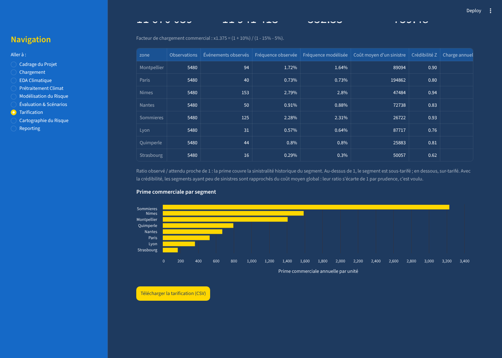
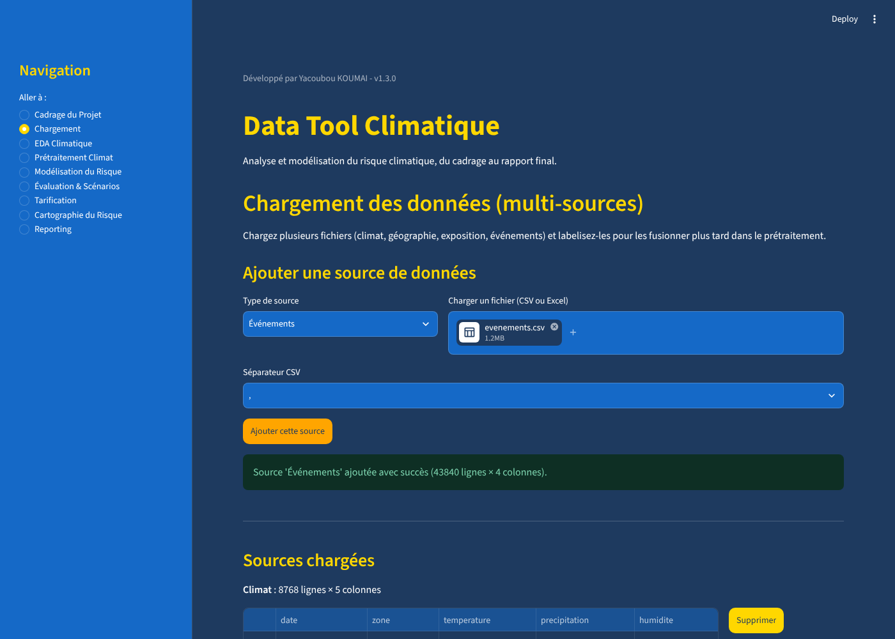

# Data Tool Climatique

Application Streamlit d'analyse et de modélisation du risque climatique, développée
pour un hackathon : cadrage du projet, chargement de plusieurs sources de données,
exploration, prétraitement, modélisation, évaluation, tarification, cartographie et rapport HTML.

Application en ligne : https://climateriskanalytics.streamlit.app/

## Aperçu

| Comparaison des modèles | Évaluation par zone |
|---|---|
|  |  |
| **Tarification** | **Chargement** |
|  |  |

## Fonctionnalités

| Section | Contenu |
|---|---|
| Cadrage du projet | Objectif métier (classification, régression, prévision), unité d'analyse, cible, contexte ; repris dans le rapport |
| Chargement | Plusieurs fichiers CSV ou Excel étiquetés par type (climat, géographie, exposition, événements, autre), fusion automatique |
| EDA climatique | Aperçu des données et série temporelle d'une variable |
| Prétraitement | Conversion des dates, agrégation journalière ou mensuelle par identifiant (somme pour les cumuls et les coûts, maximum pour les indicateurs 0/1, moyenne sinon), cumuls et moyennes glissantes calculés par zone, contrôle des valeurs extrêmes |
| Modélisation | Modèle unique, comparaison de modèles, affinage des hyperparamètres du meilleur modèle (tous les modèles qui en ont : forêts, boosting, arbre, KNN, régressions régularisées) ; choix des variables explicatives avec exclusion automatique des variables qui révèlent la cible (fuite de données), découpage temporel apprentissage / test, gestion du déséquilibre des classes, validation croisée, mode rapide. En classification, la métrique principale est l'AUC ROC, complétée par l'AUC PR |
| Évaluation | Classification : matrice de confusion, métriques détaillées, courbes précision-rappel et ROC. Régression : prédictions contre valeurs réelles, résidus, métriques orientées risque. Analyse par segment : taux d'événements observé et prédit, rappel et AUC ROC par zone |
| Tarification | Prime pure = fréquence modélisée x coût moyen d'un sinistre, par segment (zone par exemple) et par unité d'exposition ; recalage de la fréquence sur la sinistralité observée, coût moyen par segment avec crédibilité (Bühlmann), chargements de sécurité, de frais et de marge, ratio observé / attendu, export CSV |
| Cartographie | Données brutes ou fusionnées, fréquence d'inondation prédite par le modèle comparée à la fréquence observée, prime commerciale par segment ; heatmap, points, marqueurs regroupés (Folium) ou colonnes 3D (PyDeck), une valeur par lieu, plusieurs fonds de carte, filtre temporel |
| Reporting | Rapport HTML personnalisable (sections, titre, variable climatique), aperçu intégré et téléchargement |

Modèles disponibles : Random Forest, Gradient Boosting, régression logistique ou linéaire
(Ridge, Lasso), Decision Tree, Extra Trees, AdaBoost, K-Nearest Neighbors, Naive Bayes.

## Structure

```
clim_app.py                 Point d'entrée Streamlit : navigation et pages
climatool/
    data_loader.py          Lecture CSV / Excel
    data_utils.py           Fusion des sources de données
    preprocessing.py        Prétraitement climatique
    model_utils.py          Détection du type de tâche, préprocesseur, importance des variables
    model_comparison.py     Entraînement et comparaison des modèles
    tuning.py               Hyperparamètres ajustables lors de l'affinage
    evaluation.py           Évaluation du modèle
    maps.py                 Cartographie du risque
    pricing.py              Tarification : prime pure et prime commerciale
    reporting.py            Rapport HTML
    assets/style.css        Thème visuel (couleurs de base dans .streamlit/config.toml)
docs/screenshots/           Captures d'écran
docs/donnees_exemple/       Jeu de données de test (climat, exposition, événements) et son générateur
```

## Installation locale

Python 3.11 recommandé.

```bash
python -m venv .venv
source .venv/bin/activate        # Windows : .venv\Scripts\activate
pip install -r requirements.txt
streamlit run clim_app.py
```

## Données d'exemple

Le dossier `docs/donnees_exemple/` contient un jeu de données synthétique pour tester
toutes les pages. Les communes sont réelles ; les quartiers, les relevés et le portefeuille sont inventés.

| Fichier | Type à choisir | Contenu |
|---|---|---|
| `climat.csv` | Climat | Météo journalière de huit communes françaises (2022-2024) : pluie, température, humidité |
| `geographie.csv` | Géographie | Cinq quartiers (sites) par commune : coordonnées, altitude, distance au cours d'eau, zone inondable |
| `exposition.csv` | Exposition | Portefeuille par site : nombre de biens et valeur assurée moyenne, en euros |
| `evenements.csv` | Événements | Inondations par site et par jour, et coût des sinistres |

Chargez les quatre fichiers, fusionnez (sur la commune, le site et la date), puis suivez les
pages dans l'ordre. Le script `generer_donnees.py` permet de les recréer.

## Notes techniques

- Le rapport est généré en mémoire et servi en téléchargement : aucun fichier n'est écrit
  sur le serveur.
- Les cartes ont besoin de colonnes de latitude et de longitude dans les données.

## Auteur

Yacoubou KOUMAI - licence MIT
