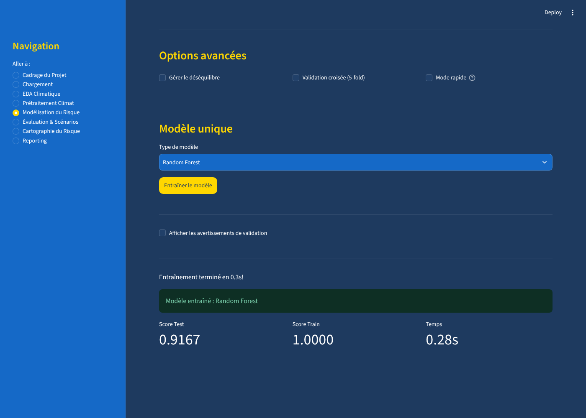
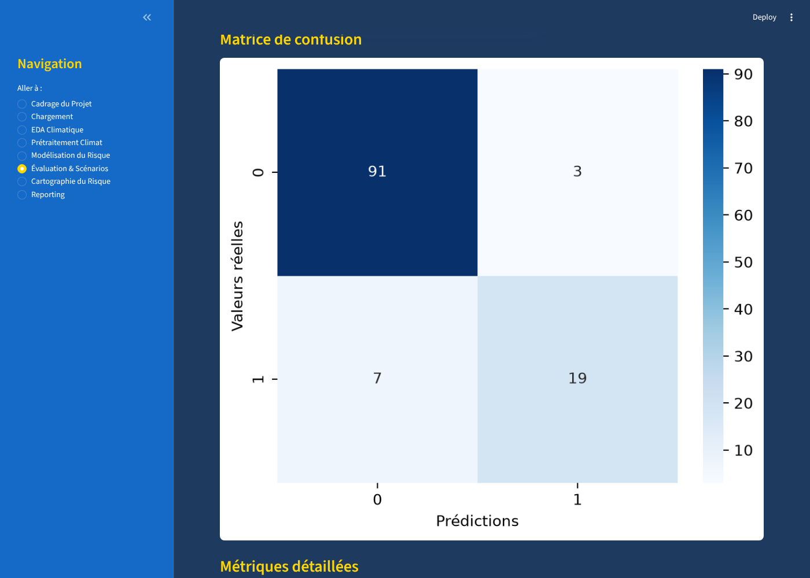

# Data Tool Climatique

Application Streamlit d'analyse et de modélisation du risque climatique, développée
pour un hackathon : cadrage du projet, chargement de plusieurs sources de données,
exploration, prétraitement, modélisation, évaluation, cartographie et rapport HTML.

Application en ligne : https://climateriskanalytics.streamlit.app/

## Aperçu

| Chargement | Modélisation | Évaluation |
|---|---|---|
|  |  |  |

## Fonctionnalités

| Section | Contenu |
|---|---|
| Cadrage du projet | Objectif métier (classification, régression, prévision), unité d'analyse, cible, contexte ; repris dans le rapport |
| Chargement | Plusieurs fichiers CSV ou Excel étiquetés par type (climat, géographie, exposition, événements, autre), fusion automatique |
| EDA climatique | Aperçu des données et série temporelle d'une variable |
| Prétraitement | Conversion des dates, agrégation journalière ou mensuelle par identifiant, moyennes glissantes, détection d'anomalies |
| Modélisation | Modèle unique, comparaison de modèles, affinage des hyperparamètres du meilleur modèle (tous les modèles qui en ont : forêts, boosting, arbre, KNN, régressions régularisées) ; gestion du déséquilibre des classes, validation croisée, mode rapide |
| Évaluation | Classification : matrice de confusion, métriques détaillées, courbes précision-rappel et ROC. Régression : prédictions contre valeurs réelles, résidus, métriques orientées risque. Analyse par segment |
| Cartographie | Heatmap, points, marqueurs regroupés (Folium) ou gradient 3D (PyDeck), plusieurs fonds de carte, filtre temporel |
| Reporting | Rapport HTML personnalisable (sections, titre, variable climatique), aperçu intégré et téléchargement |

Modèles disponibles : Random Forest, Gradient Boosting, régression logistique ou linéaire
(Ridge, Lasso), Decision Tree, Extra Trees, AdaBoost, K-Nearest Neighbors, Naive Bayes.

## Structure

```
clim_app.py                 Point d'entrée Streamlit : navigation et pages
climatool/
    data_loader.py          Lecture CSV / Excel
    data_utils.py           Fusion des sources de données
    preprocessing.py        Prétraitement climatique
    model_utils.py          Détection du type de tâche, préprocesseur, importance des variables
    model_comparison.py     Entraînement et comparaison des modèles
    tuning.py               Hyperparamètres ajustables lors de l'affinage
    evaluation.py           Évaluation du modèle
    maps.py                 Cartographie du risque
    reporting.py            Rapport HTML
    assets/style.css        Thème visuel (couleurs de base dans .streamlit/config.toml)
docs/screenshots/           Captures d'écran
```

## Installation locale

Python 3.11 recommandé.

```bash
python -m venv .venv
source .venv/bin/activate        # Windows : .venv\Scripts\activate
pip install -r requirements.txt
streamlit run clim_app.py
```

## Notes techniques

- Le rapport est généré en mémoire et servi en téléchargement : aucun fichier n'est écrit
  sur le serveur.
- Les cartes ont besoin de colonnes de latitude et de longitude dans les données.

## Auteur

Yacoubou KOUMAI - licence MIT
